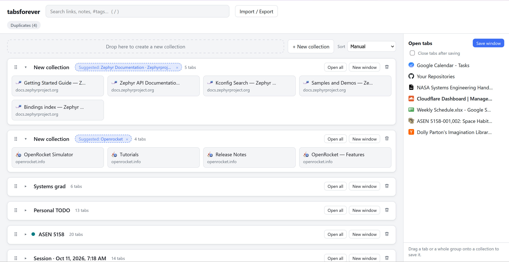
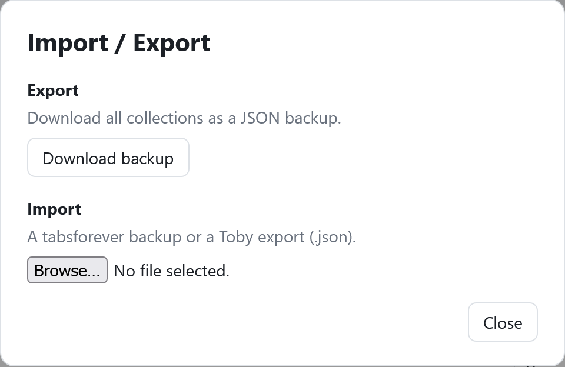

# tabsforever

A tab manager for Chrome and Firefox. Save your open tabs into collections on your new tab page, close them, and reopen them whenever you need them. Everything stays in your browser: no account, no sync, no tracking.



## Features

- **Collections on the new tab page.** Rename, collapse, reorder and delete them, with Undo after a delete. **Open all** reopens a collection in the current window, and **New window** opens it in a new one.
- **Drag to save.** The sidebar lists the tabs open in this window. Drag one onto a collection, between two cards, or onto "Drop here to create a new collection". **Save window** saves everything at once. You can turn on **Close tabs after saving**.
- **Tab groups.** Grouped tabs appear under their group's name and color. Save a whole group with **Save group** or by dragging it. **Save window** turns each group into its own collection. Collections saved from a group reopen as that group, with the same name and color.
- **Cards.** Click to open a link, or Ctrl/Cmd/middle-click to open it in the background. Drag cards to reorder them or move them between collections. Edit the title, add a note and add tags.
- **Search, tags and sorting.** Fuzzy search covers titles, URLs, notes and tags (press `/` to focus it). Tag chips filter the view. You can sort collections by name, newest, recently updated or most tabs, and your manual order is kept.
- **Duplicates.** A collection never holds the same link twice. If a link is saved in more than one collection, the **Duplicates** chip shows each copy side by side, and you choose which one to keep.
- **Name suggestions.** Collections with a placeholder name, such as "Session · …" or "Unnamed group", get a suggested name based on their tabs. Click it to use it.
- **Right-click menu and toolbar button.** Save the current tab to a new or recent collection, save its tab group, or save the whole window.
- **Import and export.** Import or export a tabsforever backup, and either merge it with your collections or replace them. Export everything as a JSON backup.



## Install

Download the latest version from [Releases](https://github.com/meljameson/tabsforever/releases/latest).

- **Firefox:** click `tabsforever-<version>-firefox.xpi` and confirm the install. It's signed by Mozilla and updates itself when a new version comes out.
- **Chrome, Edge, Brave and other Chromium browsers:** download `tabsforever-<version>-chrome.zip` and unzip it. Open `chrome://extensions`, turn on **Developer mode**, click **Load unpacked**, and choose the unzipped folder. Chromium browsers don't update extensions installed this way, so download new releases yourself.

The first time you open a new tab, the browser asks whether to keep the extension's new tab page. Choose to keep it.

### Build from source

You need Node.js 22 or newer.

```sh
npm install
npm run build            # Chrome, Edge, Brave and other Chromium browsers → .output/chrome-mv3
npm run build:firefox    # Firefox → .output/firefox-mv2
```

- **Chrome and other Chromium browsers:** open `chrome://extensions`, turn on **Developer mode**, click **Load unpacked**, and choose `.output/chrome-mv3`.
- **Firefox:** open `about:debugging#/runtime/this-firefox`, click **Load Temporary Add-on…**, and choose `.output/firefox-mv2/manifest.json`. Firefox removes temporary add-ons when it restarts.

## Development

Built with [WXT](https://wxt.dev), React and TypeScript.

| Command | What it does |
| --- | --- |
| `npm run dev` | Starts a Chromium browser with the extension loaded and reloads it on every change |
| `npm run dev:firefox` | The same, in Firefox |
| `npm test` | Runs the unit tests (Vitest) |
| `npm run compile` | Type-checks the project |
| `npm run zip` / `npm run zip:firefox` | Packages store-ready zip files |

Where things live:

- `entrypoints/newtab/`: the dashboard page
- `entrypoints/background.ts`: right-click menu and toolbar button
- `src/model/`: data types and the pure operations everything goes through (`ops.ts`), plus drag-and-drop, duplicate, sorting and name-suggestion logic
- `src/storage/db.ts`: storage and data migrations
- `src/import/`: Toby and backup import
- `src/components/`: React components
- `tests/`: unit tests

### Releasing

Releases are built by [GitHub Actions](.github/workflows/release.yml) when a version tag is pushed:

```sh
npm version patch        # or minor / major: bumps package.json and creates the tag
git push --follow-tags
```

The workflow type-checks and tests the project, builds both browsers, and gets the Firefox build signed by Mozilla as an unlisted (self-distributed) add-on. It then publishes a GitHub Release with the `.xpi` and the Chrome `.zip`, and adds the new version to [`updates.json`](updates.json). Installed Firefox copies check that file to find updates.

One-time setup: create API credentials at [addons.mozilla.org → Manage API Keys](https://addons.mozilla.org/developers/addon/api/key/), and add them as the repository secrets `AMO_JWT_ISSUER` and `AMO_JWT_SECRET`.

Don't change the Firefox add-on id (`tabsforever@meljameson.github.io`) or the `update_url` in [`wxt.config.ts`](wxt.config.ts). Installed copies rely on both to find updates.

## Your data

Collections are kept in your browser's local extension storage and nothing is sent anywhere. Uninstalling the extension deletes them, so use **Import / Export → Download backup** to keep a copy.

## Known limitations

- No sync between devices yet. Use export and import to move collections between browsers.
- Browser pages such as `about:` and `chrome://` can't be saved, because extensions aren't allowed to open them.
- Tab-group features need a browser version with tab group support for extensions. Without it, tabs are still saved, but group names and colors aren't.
- There's no custom extension icon yet.
